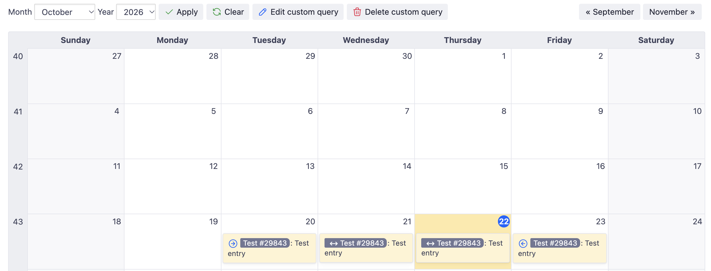

# Redmine Calendar Events Daily

A small [Redmine](https://www.redmine.org/) plugin that shows issues in the calendar on **every day** between their start date and due date.

## Introduction

Redmine offers almost everything we need out of the box. We only had to extend it a little for our internal needs, and this plugin was the result.

## Features

By default, the Redmine calendar only shows an issue on the day it starts and on the day it ends. The days in between stay empty, which makes it hard to see what is actually going on in a given week.

With this plugin:

- Issues with a start date and a due date appear on every day in between.
- Days in between are marked with a double arrow icon (↔), in addition to Redmine's usual start and end icons.
- The calendar legend gets a new entry: *issue active on this day*.
- Issues without a start date or due date are shown as before.

The legend text is available in English and German.



## Requirements

- Redmine 7.0 or higher

## Installation

1. Clone the plugin into the `plugins` directory of your Redmine installation. The directory name must be `redmine_calendar_events_daily`, as it has to match the plugin ID:

   ```bash
   cd /path/to/redmine/plugins
   git clone https://github.com/ablida/redmine_calendar_events_daily.git
   ```

   Alternatively, download the repository as a ZIP and extract it to `plugins/redmine_calendar_events_daily`.

2. Restart Redmine.

No database migrations are required. More information on installing Redmine plugins: [Redmine Plugins](https://www.redmine.org/projects/redmine/wiki/Plugins).

## Usage

No configuration is needed. After the restart, open the calendar of any project (or the global calendar) to see issues on all their days.

## Uninstallation

Remove the `plugins/redmine_calendar_events_daily` directory and restart Redmine.

## License

This plugin is licensed under the [GNU General Public License v2.0](LICENSE), unless otherwise stated.

## About

Copyright (c) 2022–2026 ablida
